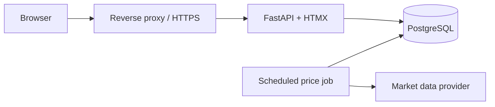

# Design notes

Architecture and implementation assessment from a static review (nothing was run). Concrete defects are tracked in [BACKLOG.md](BACKLOG.md); this file holds the design direction behind them.

## 1. Main direction: FastAPI + HTMX + Jinja

Replace Streamlit with a FastAPI app that renders Jinja templates and uses HTMX for partial updates. This applies even if the app stays local.

| Why | Detail |
|-----|--------|
| Streamlit reruns the whole script per interaction | State, messages and form handling need workarounds (C1, C6, C9). A request/response model removes the problem. |
| One language, no JS build | Server-rendered HTML; Plotly for charts. |
| Reusable backend | `core/` and `services/` stay unchanged; the same routes can later serve a SPA or mobile client. |
| Stateless server | Prerequisite for hosting and for authentication. |

Target layout:

| Path | Role |
|------|------|
| `src/trackfolio/web/routes/` | FastAPI routers (pages and HTMX fragments); call `services/` only |
| `src/trackfolio/web/templates/`, `static/` | Jinja templates and assets |
| `src/trackfolio/web/deps.py` | Dependencies: DB session, current user, service factory |

Migration steps:
1. Finish BACKLOG batches A and B (correctness, unit of work); both are UI-independent.
2. Add the FastAPI app next to Streamlit, one page at a time (Transazioni, then dashboard). Services return structured data (C8).
3. Remove Streamlit and its dependency; update README and CLAUDE.md.

The UI items in BACKLOG section C are superseded by this migration; fix only the ones that survive it (C4, C6 logic, C7, C8).

## 2. Hosted multi-user service

Builds on section 1. Tracked in [BACKLOG.md section E](BACKLOG.md#e-multi-user-hosted-service).

| Area | Direction |
|------|-----------|
| Database | PostgreSQL; Alembic migrations (B10) before any schema change. |
| Data ownership | `user` table; `user_id` on `transaction` (and on future per-user tables). `asset` and `price` stay global and shared. Every query filters by user. |
| Service API | `PortfolioService` takes the current user; no global state. |
| Authentication | Email + password with argon2 hashes, server-side sessions in secure cookies (or `fastapi-users`); optional OIDC later. CSRF protection for HTMX forms. |
| Authorization | Isolation tests: user A can never read or modify user B's data. |
| Prices | Scheduled job refreshes shared prices for all held tickers; users never trigger provider calls directly. |
| Market data | Free yfinance is unsuitable for a public service (rate limits, terms of use): put a paid provider behind `PriceProvider`. |
| Instrument search | Rate-limit per user and cache results globally (B5). |
| Configuration | Settings and secrets from environment variables (pydantic-settings); nothing in the repo. |
| Deployment | Container image, reverse proxy with HTTPS, health endpoint, structured logging. |
| Privacy | Account and data deletion, backups, no financial data in logs. |

## Keep

| Choice | Why |
|--------|-----|
| `ui → services → core` with a pure `core/` | Financial logic is testable and reusable with another frontend. |
| `PriceProvider` interface | yfinance is unofficial and may need replacing. |
| SQLite price cache, falling back to cache on network errors | Works offline; failures stay visible. |
| SQLModel for models and queries | Typed models; works on SQLite and PostgreSQL. |
| uv, ruff, mypy strict | Reproducible and consistent. |

## Change

| Topic | Issue | Direction |
|-------|-------|-----------|
| Return metric | Return % on net cash flow changes meaning after every sale ([A6](BACKLOG.md#a-correctness-in-core)). | Prioritize cost basis of open positions, then TWR/XIRR ([D2](BACKLOG.md#d-returns-and-features)). |
| Position replay | `validate_transaction` and `calculate_positions` each replay history, which produced A4 and A5. | One replay routine in `core/positions.py`, used by both. |
| Persistence | Scattered commits and no migrations (B1, B10). | Commit once in the service. Adopt migrations (e.g. Alembic) before the first schema change so user data survives. |
| Instrument lookup | An ISIN search chains many slow, flaky yfinance calls (`Ticker.get_info`, `Search`). | Build `Asset` from search-result data, call `get_info` only for the selected listing, cache the result (B5). |
| Presentation in the service | Italian warning strings built in `services/` (C8). | The service returns structured data; the UI translates. |
| Money type | `float` with ad hoc tolerances such as `1e-9`. | Keep `float`; centralize tolerances and rounding. Move to `Decimal` only if precision errors appear. |
| Calendar | Business-day index (`freq="B"`) ignores exchange holidays and forward-fills FX across weekends. | Keep; document it in the README if it matters to users. |

## Not now

- **SPA frontend (React/Svelte):** only if HTMX proves insufficient or a mobile app is needed.
- **Ticker as asset primary key:** the same instrument listed on several exchanges becomes separate assets. Revisit with multi-portfolio support.
