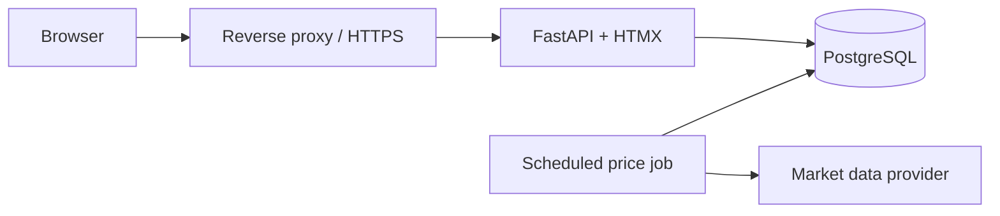

# Design notes

Design direction and open work. Items are done when removed from here: delete or rewrite them in the same change that implements them. Product roadmap: [README.md](README.md#roadmap).

## 1. Web layer: FastAPI + HTMX + Jinja

The UI is a FastAPI app rendering Jinja templates, with HTMX for partial updates and Plotly for charts. It is stateless, which is the prerequisite for hosting and authentication, and `core/` and `services/` stay UI-independent, so the same routes can later serve a SPA or mobile client.

| Path | Role |
|------|------|
| `src/trackfolio/web/app.py` | App factory; runs `init_db()` at startup |
| `src/trackfolio/web/routes/` | Routers (pages and HTMX fragments); call `services/` only |
| `src/trackfolio/web/templates/`, `static/` | Jinja templates, CSS and vendored HTMX |
| `src/trackfolio/web/deps.py` | Dependencies: DB session, provider, service factory |

## 2. Hosted multi-user service

Builds on section 1; PostgreSQL support, Alembic migrations and settings from the environment are already in place. Order matters: E4 before E5, E6 after both.

| ID | Area | Work |
|----|------|------|
| E4 | Data ownership | `user` table; `user_id` on `transaction` (and on future per-user tables); `asset` and `price` stay global and shared. `PortfolioService` takes the current user, every query filters by user, no global state. |
| E5 | Authentication | Email + password with argon2 hashes, server-side sessions in secure cookies (or `fastapi-users`), login/logout/register pages; optional OIDC later. CSRF protection for HTMX forms. |
| E6 | Authorization | Isolation tests: user A can never read or modify user B's data. |
| E7 | Prices | Scheduled job refreshes shared prices for all held tickers; users never trigger provider calls, so the per-user refresh button goes away. |
| E8 | Market data | Free yfinance is unsuitable for a public service (rate limits, terms of use): put a paid provider behind `PriceProvider`. |
| E9 | Instrument search | Rate limiting on auth and search; persistent global cache for search results (metadata is cached in memory per process today). |
| E10 | Deployment | Container image, reverse proxy with HTTPS, health endpoint, structured logging without financial data. |
| E11 | Privacy | Account and data deletion; backup and restore procedure. |

## Keep

| Choice | Why |
|--------|-----|
| `web → services → core` with a pure `core/` | Financial logic is testable and reusable with another frontend. |
| `PriceProvider` interface | yfinance is unofficial and may need replacing. |
| SQLite price cache, falling back to cache on network errors | Works offline; failures stay visible. |
| SQLModel for models and queries | Typed models; works on SQLite and PostgreSQL. |
| uv, ruff, mypy strict | Reproducible and consistent. |

## Change

| Topic | Issue | Direction |
|-------|-------|-----------|
| Position replay | `validate_transaction` and `calculate_positions` each replay history, which is duplicated logic. | One replay routine in `core/positions.py`, used by both. |
| Instrument lookup | An ISIN search chains many slow, flaky yfinance calls (`Ticker.get_info`, `Search`). | Build `Asset` from search-result data, call `get_info` only for the selected listing, persist the result (E9). |
| Money type | `float` with ad hoc tolerances such as `1e-9`. | Keep `float`; centralize tolerances and rounding. Move to `Decimal` only if precision errors appear. |
| Calendar | Business-day index (`freq="B"`) ignores exchange holidays and forward-fills FX across weekends. | Keep; document it in the README if it matters to users. |

## Not now

- **SPA frontend (React/Svelte):** only if HTMX proves insufficient or a mobile app is needed.
- **Ticker as asset primary key:** the same instrument listed on several exchanges becomes separate assets. Revisit with multi-portfolio support.
